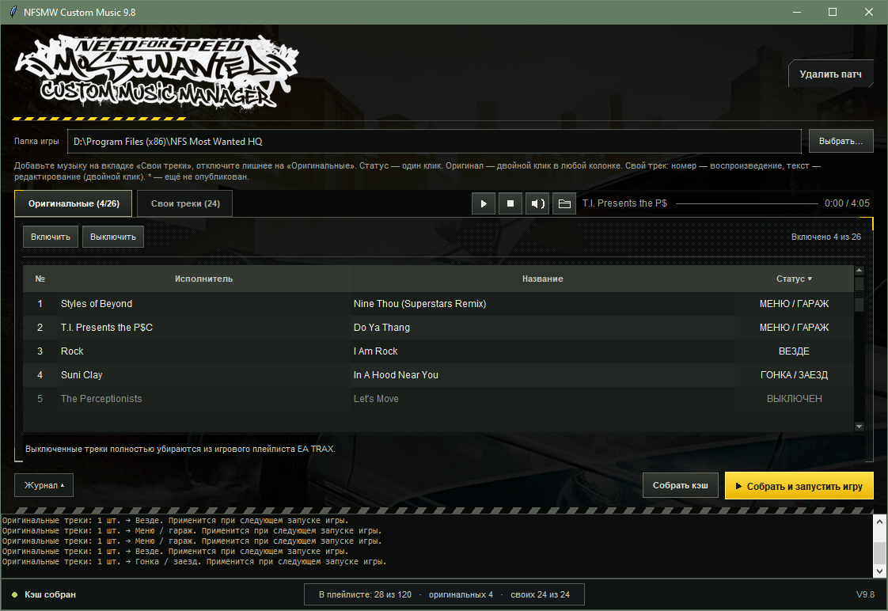

# NFSMW Custom Music

Менеджер музыки для **Need for Speed: Most Wanted (2005)**: добавляйте свои треки, управляйте оригинальными и слушайте музыку прямо в программе.

## Возможности

- Добавление MP3, WAV и M4A, в том числе перетаскиванием.
- Управление треками и режимами воспроизведения в игре.
- Прослушивание оригинальной музыки с извлечением в фоновом режиме.
- Повторное использование кэша: готовые треки не перекодируются без необходимости.

## Технологии

- **Python и Tkinter** — интерфейс и встроенный плеер Windows MCI.
- **FFmpeg** — подготовка и нормализация аудио.
- **EA-XA Encoder** — кодирование музыки в игровой формат.
- **vgmstream** — декодирование оригинальной музыки игры.
- **ASI-патч и загрузчик** — подключение музыки к игре; мост основан на MW-EA-TRAX-Expansion.
- **PyInstaller** — сборка в один EXE.

## Запуск

Для работы требуется Windows и установленная Need for Speed: Most Wanted (2005). Укажите папку игры, установите патч, добавьте музыку и нажмите **«Собрать и запустить игру»**.

Для сборки EXE положите `Icon.png` рядом с двумя Python-файлами и запустите `Build NFSMW Custom Music.bat`.
